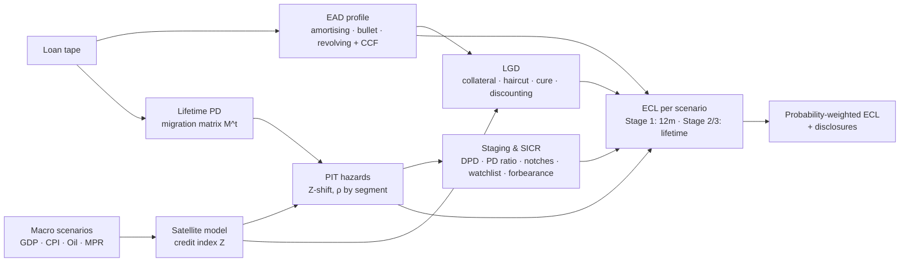

# IFRS 9 Expected Credit Loss Engine

**Live demo:** https://eci-ifrs9-ecl-engine-knowel.streamlit.app

An end-to-end, loan-level IFRS 9 impairment engine: **staging with auditable SICR triggers, lifetime PD term structures from rating migration, collateral-driven LGD, amortising / revolving EAD profiles, and probability-weighted macroeconomic scenarios** — with an interactive Streamlit dashboard and disclosure-ready Excel output.

Built on a synthetic 5,000-facility Nigerian bank portfolio (₦1.06trn EAD across Retail, SME and Corporate) so it can be shared publicly. Point it at your own loan tape and it runs the same way.

> Author: **Emmanuel C. Iheme** — Insight Analytics & Risk Profiling Analyst · Basel III · IFRS 9 · CBN Risk-Based Supervision

---

## Results on the demo portfolio

| Metric | Value |
|---|---|
| Facilities | 5,000 |
| EAD | ₦1,060bn |
| Probability-weighted ECL | ₦18.0bn |
| Coverage | 1.70% |
| Stage 2 / Stage 3 share of EAD | 21.6% / 2.4% |
| Coverage by stage | 0.5% / 2.6% / 30.7% |
| Downside vs Base ECL | +78% |
| Non-linearity uplift (weighted vs Base) | +18% |

Runs in under a second for 5,000 facilities on a quarterly grid of up to 25 years.

## How it works



**Core formula** (per scenario, quarterly grid, discounted at EIR):

```
ECL_s = Σ_q  Survival(t_q) × Hazard(q) × LGD(q) × EAD(q) × (1 + EIR)^-(t_q + ¼)
ECL   = Σ_s  w_s × ECL_s
```

| Component | Approach |
|---|---|
| **Staging** | Stage 3: ≥90 DPD or unlikely-to-pay. Stage 2: ≥30 DPD, lifetime PD ≥2.5× origination *and* +1pp, ≥3-notch downgrade, watchlist, forbearance. Optional low-credit-risk exemption. Every facility records which triggers fired. |
| **Lifetime PD** | Annual 8-grade + default migration matrix per segment → cumulative PD via matrix powers → conditional hazards → PIT via Vasicek Z-shift → quarterly. Cohort estimator included for real migration data. |
| **Forward-looking info** | 3 scenarios with 3-year macro paths, linear satellite model to Z, mean reversion to TTC over 2 years. |
| **LGD** | Collateral value × macro index × (1 − haircut), discounted over time-to-recovery; residual treated as unsecured; cure rate; floor. Time-varying as balances amortise. |
| **EAD** | Annuity amortisation with prepayment; bullet; revolving drawn + CCF × undrawn over behavioural life. |

Full detail, parameter tables and IFRS 9 paragraph references: [`docs/METHODOLOGY.md`](docs/METHODOLOGY.md).

## Dashboard

| Tab | What it shows |
|---|---|
| Overview | ECL and coverage by segment/stage, disclosure tables by stage and product |
| Staging & SICR | Stage migration matrix, trigger attribution, PD-now vs PD-at-origination scatter with the threshold line, Stage 2 cliff effect |
| PD term structure | Cumulative PD curves by grade, TTC vs each scenario |
| LGD & EAD | LGD by product and collateral, distribution, exposure run-off for any facility |
| Macro scenarios | ECL by scenario, Z paths, non-linearity adjustment, macro paths |
| Loan drill-down | Filterable loan-level results, Excel download |

Sidebar controls let you re-weight scenarios and change every SICR threshold live, which makes it easy to show how sensitive Stage 2 and the overall allowance are to policy choices.

## Quick start

```bash
git clone https://github.com/emmanueliheme/ifrs9-ecl-engine.git
cd ifrs9-ecl-engine
pip install -r requirements.txt

streamlit run app.py            # dashboard
python run_ecl.py               # CLI → outputs/ecl_results.xlsx + .csv
python run_ecl.py --weights 0.1 0.5 0.4
python run_ecl.py --portfolio data/sample_portfolio.csv
pytest -q                       # 23 tests
```

### Use as a library

```python
from ecl_engine import EngineConfig, StagingPolicy, generate_portfolio, run_ecl, reporting

cfg = EngineConfig()
cfg.scenarios["Downside"]["weight"] = 0.40
cfg.staging = StagingPolicy(pd_relative_threshold=3.0, low_credit_risk_exemption=False)

res = run_ecl(generate_portfolio(10_000), cfg)
reporting.stage_summary(res, by="segment")
reporting.migration_matrix(res)
reporting.export_excel(res, "ecl.xlsx")
```

### Bring your own data

A CSV/XLSX with these columns (see `ecl_engine/data.py::REQUIRED_COLUMNS`):
`loan_id, segment, product, facility_type, remaining_term_years, age_years, eir, drawn_balance, undrawn_limit, collateral_type, collateral_value, orig_grade, current_grade, prior_grade, dpd, prior_dpd, watchlist, forborne, default_flag`.
`data/sample_portfolio.csv` is a 500-row template.

## Excel output

`Headline · By Stage · By Segment · By Product · Stage Migration · SICR Triggers · Scenarios · Macro Paths · Stage 2 Cliff · Loan Level`

## Project structure

```
ecl_engine/
  config.py      all assumptions: grades, segments, collateral, products, scenarios, SICR policy
  data.py        synthetic portfolio generator + input validation
  macro.py       satellite model and Z paths
  pd_model.py    migration matrices, cohort estimator, term structures, PIT conditioning
  ead.py         exposure profiles
  lgd.py         collateral-driven, scenario-sensitive LGD
  staging.py     stage allocation with trigger audit trail
  ecl.py         orchestration and probability weighting
  reporting.py   disclosure tables and Excel export
app.py           Streamlit dashboard
run_ecl.py       CLI
tests/           unit and integration tests
docs/            methodology
```

## Limitations

Calibrations are illustrative and the data is synthetic — this demonstrates methodology and engineering, not a bank's actual allowance. See the limitations section of the methodology for what a production deployment would add (calibrated matrices and satellite models, stored origination PD curves, probation periods, management overlays).

## Licence

MIT
